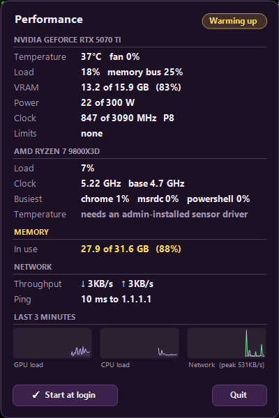

# Perf Widget

A performance strip that lives inside the Windows 11 taskbar. Native C# built with the
compiler that ships with Windows, no dependencies, no admin, single instance, starts at login.

Windows 11 removed taskbar toolbars, so nothing built in can show you GPU temperature, load,
VRAM, CPU clock, memory and network at a glance. This puts them in the empty space left of the
centered icons, and it stays there: no overlay window to lose behind a game, nothing to pin.

## What it shows

    [thermometer]  GPU 64°  98%  294W  VRAM 13.6G  |  CPU 17%  5.2GHz  |  MEM 24.6G  |  NET ↓ 5K ↑ 48K  6ms

- A thin bar under each group: GPU load, VRAM used, CPU load, memory used, and download and
  upload activity on a log scale (10 KB/s empty, a full gigabit full). Bars and the thermometer
  glide to each new value.
- The thermometer's mercury height is the GPU temperature (20 to 90 C spans the tube); its tint
  is the overall level.
- Values tint by severity: plain when fine, yellow when warming, orange when hot, red when
  throttling. When the GPU is actually throttling, the pill breathes with a red halo.
- The pill brightens under the mouse. Click it (left or right) for the details panel.

The panel adds GPU name, fan, memory bus load, power vs limit, clock vs max, P-state and the
driver's active clock limits; CPU clock vs base and the three busiest processes; network
throughput and ping; three-minute sparklines for GPU load, CPU load and network; a Start at
login toggle and Quit. Escape or clicking elsewhere closes it.

## Severity ladder

| Source | Yellow | Orange | Red |
|---|---|---|---|
| GPU temperature | 75 C | 82 C | 87 C, or any of hw_slowdown, sw_thermal, hw_thermal, hw_power_brake reported by the driver |
| System memory | 85 % used | 92 % | 97 % |
| CPU (no temperature available) | busy (90 %+) and effective clock under base | busy and under 85 % of base | never |
| Ping to 1.1.1.1 | 80 ms | 150 ms, or no reply | never |

Running at the GPU power limit (sw_power_cap) is normal under full load and is deliberately not
a warning. Network is its own signal and never tints the thermometer. Thresholds live in
`src/Severity.cs` with tests beside them.

## Data sources (all non-admin)

- GPU: `nvml.dll` from the NVIDIA display driver, called directly (microseconds per sample).
  Shows `--` if NVML is not there, so a non-NVIDIA machine still gets the rest.
- CPU: performance counters `Processor Information(_Total)` `% Processor Time` and
  `% Processor Performance`; load = time x performance (what Task Manager shows), clamped to
  100. `% Processor Utility` is not used because on at least one Ryzen board it echoes the
  performance counter. Base clock from the registry `~MHz`. Effective clock = base x perf.
- Memory: `GlobalMemoryStatusEx`.
- Network: byte counters of the physical adapters only (virtual switches, tunnels and VPNs are
  skipped so nothing is counted twice), plus one ICMP echo to 1.1.1.1 every four seconds.
- Busiest processes: per-process CPU time deltas, computed only while the panel is open.
- CPU temperature: not available without a kernel driver. Ryzen Tctl (and Intel DTS) need a
  ring0 driver such as the one in LibreHardwareMonitor, which needs an elevated process. The
  non-admin ACPI thermal zone counter is a fixed placeholder on many boards and is never shown.

Polls every 2 seconds. Measured cost on a 9800X3D: about 0.3 % of one core idle, under 1 %
while animating, ~70 MB working set.

## Build and install

Requires nothing beyond Windows 10/11 (the .NET Framework 4.8 compiler is part of the OS).

    git clone https://github.com/voidharbor/perf-widget.git
    cd perf-widget
    powershell -ExecutionPolicy Bypass -File .\build.ps1

`build.ps1` runs the ladder tests, compiles with `csc.exe`, installs to
`%LOCALAPPDATA%\Programs\PerfWidget\PerfWidget.exe`, writes a Startup shortcut and launches
it. Flags: `-NoLaunch`, `-NoStartup`, `-TestsOnly`. Start at login is togglable from the panel
afterward.

## Command line

    PerfWidget.exe                 run (exits at once if already running)
    PerfWidget.exe --details       toggle the details panel of the running instance
    PerfWidget.exe --quit          quit the running instance
    PerfWidget.exe --startup on    write the Startup shortcut (off removes it)
    PerfWidget.exe --probe <file>  write one reading to a file and exit

## Layout

- `src/` C# 5 sources. `Severity.cs` is the pure ladder and number formatting, `Sensors.cs`
  the sampler, `WidgetForm.cs` the taskbar strip, `DetailsForm.cs` the panel, `Program.cs` the
  single-instance guard, hidden message window and the re-embed watchdog.
- `tests/SeverityTests.cs` console tests, run on every build.

## How it sits on the taskbar

There are no deskbands on Windows 11, so the strip is a layered (per-pixel alpha) child window
created directly inside `Shell_TrayWnd` and kept above the XAML taskbar sibling with `HWND_TOP`
on every tick. `WS_EX_NOACTIVATE` means it never takes focus. The taskbar's own acrylic tint
shows through the transparent parts. If Explorer restarts, the child dies with the taskbar; the
watchdog notices (also via the `TaskbarCreated` broadcast) and rebuilds it.

The left inset (68 px) clears the weather/widgets button. The strip is 48 px tall and about
710 px wide at 96 dpi. Every bitmap is pinned to the taskbar's DPI (`GetDpiForWindow`) and the
layout is re-measured when that DPI changes.

## Notes for anyone reading the code

Three things cost real time to work out:

- A WinForms `Form` with `TopLevel = false` fails in `CreateHandle` unless `CreateParams.Parent`
  is the taskbar; calling `SetParent` afterwards is too late.
- GDI+ captures its default bitmap resolution once at process start from whichever display was
  primary at that moment. A 150 % virtual display (a Moonlight session) made every string render
  1.5x too big. `Bitmap.SetResolution` to the taskbar's DPI fixes it.
- Message-only windows never receive `TaskbarCreated`; the hidden window that listens for it has
  to be a real (invisible) top-level window.

Built and tested on an RTX 5070 Ti with a Ryzen 7 9800X3D, Windows 11 25H2, one 3440x1440
display at 96 dpi. Other GPUs, DPIs and taskbar positions are untested; reports welcome.
